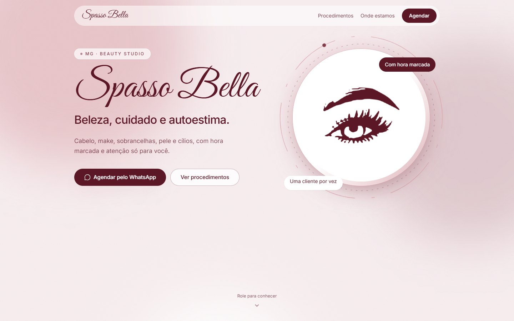
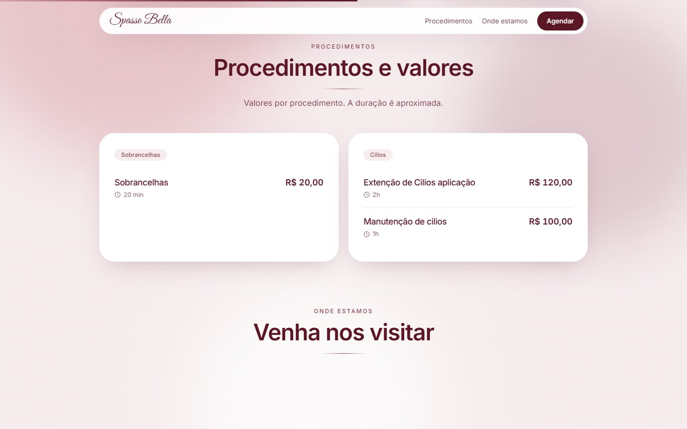
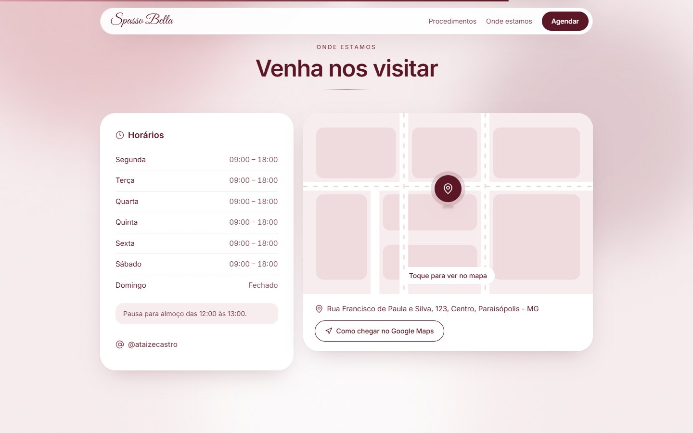
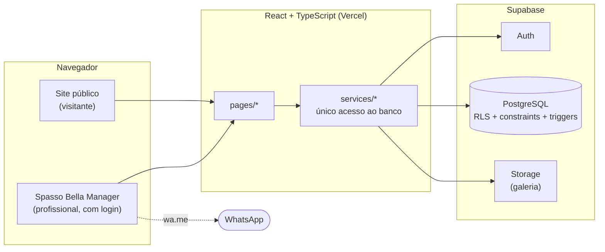

<div align="center">


# Spasso Bella MG

**Sistema de gestão + site para um studio de beleza de uma profissional só.**
Agenda, clientes, financeiro, estoque e um site animado — pensado para o celular, para ser usado todos os dias.

<p>
  
  
  
  
  
  
  
</p>



</div>

---

## ✦ A história

O Spasso Bella é o studio de beleza da minha mãe: cabelo, make, design de sobrancelhas, limpeza de pele, brow lamination, lash lifting e extensão de cílios — tudo feito por **uma única profissional**.

A agenda vivia no papel, os pagamentos no caderno e o estoque na memória. Este projeto troca isso por um sistema que ela usa **no celular, entre um atendimento e outro**. Por isso a regra de ouro do produto:

> **Cadastrar uma cliente, marcar um horário e receber um pagamento — cada um em poucos toques.**

O mesmo projeto entrega o **site público** do studio, que lê os mesmos dados (serviços, preços, horários) com permissões diferentes.

<table>
  <tr>
    <td width="33%"></td>
    <td width="67%">
      
      
    </td>
  </tr>
</table>

## ✦ O que tem

### Spasso Bella Manager — a área da profissional

| Módulo | O que faz |
| --- | --- |
| **Visão geral** | Agenda do dia, faturamento do mês, alerta de estoque, aniversariantes e **lembretes de amanhã** |
| **Agenda** | Dia e semana, novo atendimento com fim calculado pela duração, remarcar, status, **horário ocupado é impossível** |
| **Clientes** | Busca sem acento, ficha com histórico e total pago, **exportar e excluir dados (LGPD)** |
| **Serviços** | Preço, duração, categoria, ativo/inativo e se aparece no site |
| **Financeiro** | Pagamento parcial (sinal + restante), despesas com categorias próprias, **"a receber"** e fechamento do mês por forma de pagamento |
| **Estoque** | Entrada, saída e ajuste por contagem; alerta de reposição |
| **Relatórios** | Faturamento dos últimos 6 meses, serviços mais feitos, ticket médio e faltas |
| **Configurações** | Dados do studio, horário e almoço, textos do WhatsApp com prévia e galeria de fotos |

### Site público

Abertura animada, procedimentos com preço, galeria, horários, mapa com o pino do salão e botão de agendar pelo WhatsApp — além de **Política de Privacidade**, **Termos de Uso** e uma **página 404** própria.


## ✦ Destaques técnicos

**O banco é quem garante as regras — não só a tela.**

- 🗓️ **Agenda sem conflito por construção.** Uma *exclusion constraint* do PostgreSQL (`tstzrange` + GiST) recusa horários sobrepostos, ignorando cancelados. Atendimento e itens são salvos numa única função (`save_appointment`), na mesma transação.
- 💸 **Preço histórico.** Nome, preço e duração do serviço são copiados para o atendimento: mudar a tabela de preços não reescreve o passado.
- 📦 **Estoque só por movimentação.** Um *trigger* atualiza a quantidade; movimentações são imutáveis e a correção é um ajuste. O banco não deixa o estoque ficar negativo.
- 🔐 **RLS em todas as tabelas.** Ter login não basta: só a conta listada em `admins` (via `public.is_admin()`) acessa os dados. O site lê só o que é público.
- 🕐 **Fuso certo, sempre.** Horários gravados como `timestamptz` e exibidos em `America/Sao_Paulo`; datas sem hora são `date` (nada de "pagamento que aparece no dia anterior").

**Feito para pessoas reais.**

- 📱 **Mobile-first** (testado em 360 px), barra inferior no celular e menu lateral no computador, toques de 44 px.
- ♿ **Acessibilidade WCAG 2.1 AA:** contraste medido em todas as combinações de cor, foco visível, "pular para o conteúdo", janelas que prendem e devolvem o foco, erros ligados aos campos.
- 🛡️ **LGPD de verdade:** nenhum rastreamento, fontes hospedadas no próprio site, mapa do Google só com permissão, coleta mínima, aviso sobre dado de saúde e direitos da cliente (exportar/excluir). Detalhes em [`docs/auditoria-lgpd-acessibilidade.md`](docs/auditoria-lgpd-acessibilidade.md).
- 💬 **WhatsApp sem API paga:** links `wa.me` com textos editáveis e marcação de "lembrete enviado". Sem risco de banimento e sem custo por mensagem.
- ✨ **Animações com respeito:** `motion` só no site público (o painel não baixa a biblioteca) e tudo para quando o celular pede "reduzir movimento".
- ⚡ **Leve:** cada tela carrega sob demanda; o pacote inicial tem ~60 KB.

## ✦ Arquitetura



Nenhuma tela fala com o Supabase diretamente: tudo passa por `src/services/`, que traduz erros do banco em mensagens simples ("Esse horário já está ocupado").

## ✦ Stack

| Camada | Tecnologia |
| --- | --- |
| Interface | React 19, TypeScript, Tailwind CSS v4, Lucide |
| Rotas e formulários | React Router, React Hook Form + Zod |
| Datas e gráficos | date-fns + date-fns-tz, Recharts |
| Animações (site) | motion |
| Dados | Supabase (PostgreSQL, Auth, Storage) |
| Build e hospedagem | Vite, Vercel |

## ✦ Rodando na sua máquina

```bash
git clone https://github.com/eigabycastro/spasso-bella.git
cd spasso-bella
npm install
cp .env.example .env.local   # preencha a URL e a chave pública (publishable/anon) do Supabase
npm run dev                  # http://localhost:5173
```

**Banco de dados (Supabase):**

1. No **SQL Editor**, rode os arquivos de [`supabase/migrations/`](supabase/migrations/) **em ordem** (`…000001` até `…000006`).
2. Em **Authentication → Users**, crie a conta da profissional (marque *Auto Confirm User*).
3. Rode [`supabase/setup/criar-admin.sql`](supabase/setup/criar-admin.sql) com o e-mail dela para liberar o acesso.
4. Em **Authentication → Sign In / Providers**, desligue *Allow new users to sign up*.

> Só a chave **pública** vai para o front-end. A chave secreta (`service_role`) nunca entra no código — se ela for colocada por engano, o app avisa na tela de login e não se conecta.

| Comando | O que faz |
| --- | --- |
| `npm run dev` | Ambiente de desenvolvimento |
| `npm run build` | Checa os tipos e gera a versão de produção |
| `npm run lint` | Verifica o código com oxlint |

## ✦ Publicando (Vercel)

1. Importe o repositório na Vercel (ela detecta o Vite).
2. Em *Environment Variables*, crie `VITE_SUPABASE_URL` e `VITE_SUPABASE_ANON_KEY`.
3. Faça o deploy. O [`vercel.json`](vercel.json) cuida das rotas do app ao recarregar a página.

## ✦ Estrutura

```
src/
  components/   ui (Button, Modal…), layout (menus), shared (Reveal, StatCard…)
  pages/        uma pasta por módulo: agenda, clientes, financeiro, site…
  services/     único lugar que fala com o Supabase
  hooks/        dados, login e preferências
  utils/        datas, dinheiro, WhatsApp, consentimento
supabase/
  migrations/   SQL versionado (nunca editar uma migration já aplicada)
docs/           auditoria de LGPD e acessibilidade, prints
```

As regras de desenvolvimento do projeto (identidade visual, segurança, acessibilidade) estão no [`CLAUDE.md`](CLAUDE.md).

## ✦ Próximos passos

- [ ] Lembretes automáticos pela API oficial do WhatsApp (Meta)
- [ ] Agendamento online direto pelo site
- [ ] PWA: instalar no celular como aplicativo

---

<div align="center">

Feito com 💕 por **[@eigabycastro](https://github.com/eigabycastro)** para o studio da minha mãe.

<sub><i>Beleza · Cuidado · Autoestima</i></sub>

</div>
